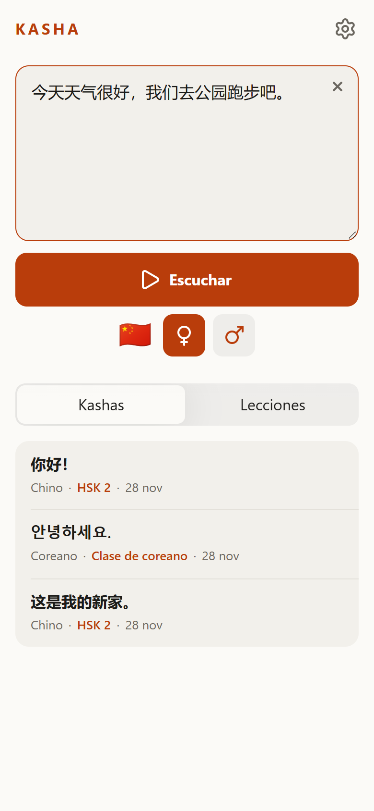
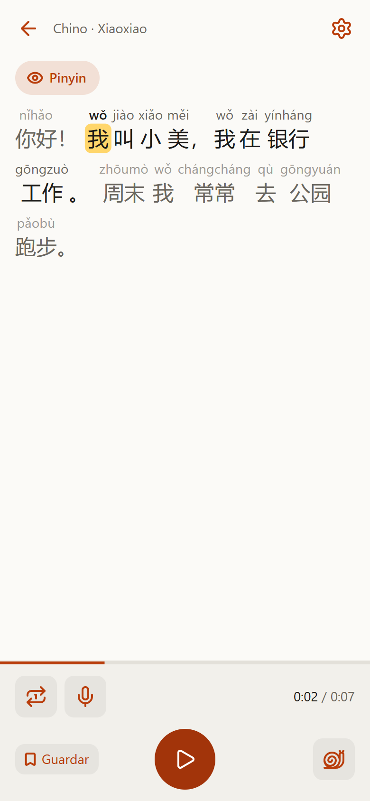
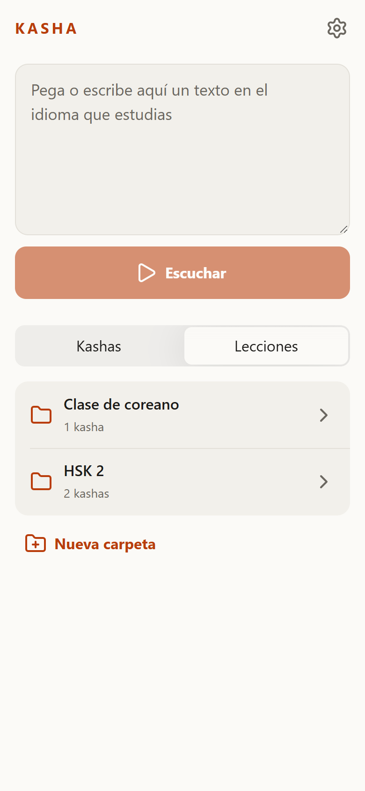

  <picture>
    <source media="(prefers-color-scheme: dark)" srcset="docs/images/kasha-dark.png">
    
  </picture>

  <a href="README.md">English</a> · <b>Español</b> · <a href="README.ru.md">Русский</a>

<h3 align="center"><i>Каша в голове</i></h3>

  ¿Aprender idiomas te deja la cabeza hecha gachas? 
  <b>KA</b>raoke <b>SHA</b>dowing te lo da cucharada a cucharada.

  <i>Kasha v golove</i>, «gachas en la cabeza», es como se dice en ruso que tienes la cabeza hecha un lío.

  
  
  
  
  
  

Pegas un texto en el idioma que estudias y lo escuchas con cada palabra marcada mientras suena. Tú repites detrás: eso es el *shadowing*.

| 1 · Pega y escucha | 2 · Escucha y repite | 3 · Guárdala |
|:---:|:---:|:---:|
|  |  |  |
| Kasha reconoce el idioma solo. La bandera te dice cuál; con ♀ y ♂ eliges voz de mujer o de hombre. | La palabra que suena se marca, con el pinyin encima. Tú la repites detrás. | Cada texto con su audio es una **kasha**. La guardas en una carpeta y la practicas cuando quieras. |

## Lo que ya hace

- **Reconoce el idioma** del texto y lo lee siempre con la misma voz de ese idioma, de mujer o de hombre. La de siempre se elige en Ajustes, y en el inicio puedes cambiarla solo para ese texto.
- **Pinyin** encima de cada palabra en chino y **romanización** en coreano. Se quita con un botón.
- **Más despacio** con el botón del caracol, sin que la voz se vuelva grave.
- **Repetir frase**: la misma frase en bucle hasta que te salga.
- **Pausa para repetir**: después de cada frase se calla el tiempo justo para que la digas tú.
- **Toca una palabra** y salta ahí.
- **Carpetas** para ordenar tus kashas, y carpetas dentro de carpetas.
- **Ajustes** a un toque desde cualquier pantalla.
- **Se instala como una app** (Ajustes → «Instalar Kasha») y abre sin conexión. Para generar audio nuevo sí hace falta internet.
- **El móvil enseña qué suena** en la pantalla de bloqueo, con el icono de Kasha.
- **Todo se queda en tu móvil.** No hay cuentas. El texto solo sale del móvil para convertirlo en voz, con las voces de Microsoft Edge.
- En **español, inglés y ruso**, con tema claro y oscuro.

## Lo que viene

- **Traducción** debajo de cada frase, con un botón para verla o esconderla.
- **Pinyin más fiable.** Hoy acierta unas 19 de cada 20 sílabas en frases difíciles. Falla sobre todo en los tonos neutros (学生 es xuésheng, no xuéshēng) y en caracteres que cambian según la frase, como 得 o 地.

### Ideas para más adelante

Si quieres alguna antes, dínoslo.

- **Grábate y compárate.** En tu turno, Kasha te graba y luego suena tu frase justo después de la original, para que oigas la diferencia.
- **Practicar sin mirar.** Un botón cambia lo que ves: el texto entero, solo las iniciales de cada palabra o nada.
- **Una voz por personaje** en los diálogos con «A:» y «B:». Con el **modo papel** silencias a uno y lo dices tú.
- **Botones en la pantalla de bloqueo** y en los auriculares: reproducir, pausar y cambiar de frase con el móvil en el bolsillo.
- **Nota de pronunciación.** Lees la frase en voz alta y Kasha marca las palabras que no ha entendido. Depende del reconocimiento de voz del móvil, que falla con algunos acentos.
- **Copia de seguridad** de tus kashas en un archivo, con sus audios, por si cambias de móvil.
- **Retoques pequeños:** si se corta internet a mitad de generar, que siga donde iba; una kasha de ejemplo la primera vez que abres la app; cuántas veces has practicado cada kasha; y que cada frase suene 2 o 3 veces y pase sola a la siguiente.

---

¿Vas a tocar el código? Todo lo técnico está en [docs/DEVELOPMENT.md](docs/DEVELOPMENT.md) (en inglés). Código abierto con licencia [MIT](LICENSE).
