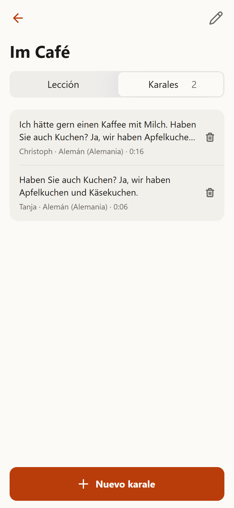
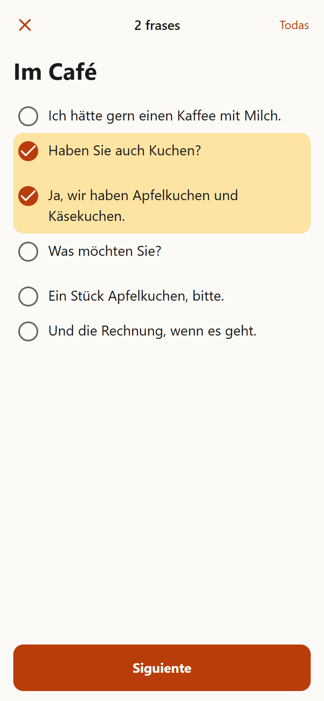
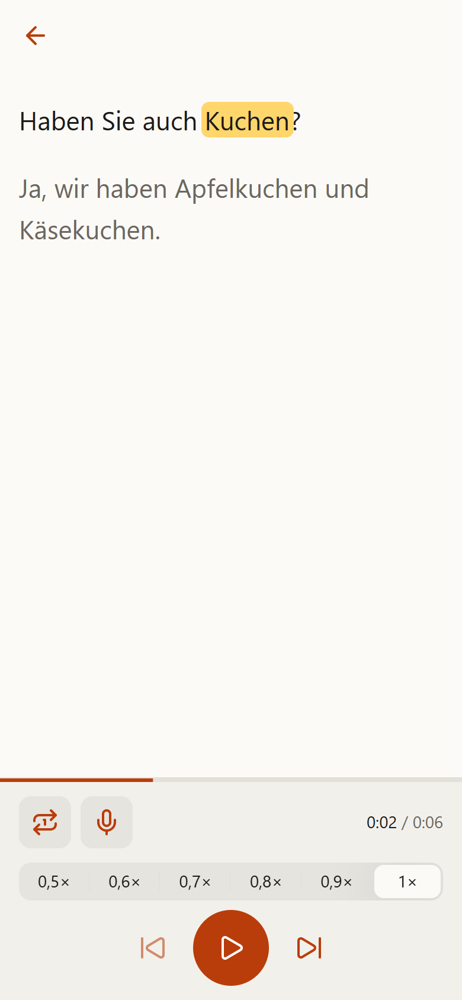

  

<h1 align="center">Kasha</h1>

<b>KA</b>raoke <b>SHA</b>dowing

  Pegas un texto en el idioma que estudias, eliges una voz y lo escuchas 
  con cada palabra marcada mientras suena. Tú repites detrás: <i>shadowing</i>.

 

| 1 · Guarda la lección | 2 · Elige las frases | 3 · Escucha y repite |
|:---:|:---:|:---:|
|  |  |  |
| Un diálogo, un artículo, tus apuntes. Se queda en tu móvil como una nota. | Tocas las frases que quieres practicar, o «Todas». Eliges la voz. | La palabra que suena se marca. Cada trozo con su audio es una **kasha**. |

## Lo que ya hace

- **Velocidad** de 0,5× a 1×, sin que la voz se vuelva grave.
- **Repetir frase**: la misma frase en bucle hasta que te salga.
- **Pausa para repetir**: después de cada frase se calla el tiempo justo para que la digas tú.
- **Toca una palabra** y salta ahí.
- **Voces favoritas**, para no buscar la tuya cada vez.
- **Se instala como una app** (Ajustes → «Instalar Kasha») y abre sin conexión. Para generar audio nuevo sí hace falta internet.
- **Todo se queda en tu móvil.** No hay cuentas. El texto solo sale del móvil para convertirlo en voz, con las voces de Microsoft Edge.
- En **español, inglés y ruso**, con tema claro y oscuro.

## Lo que viene: eliges tú

Estas son las ideas que tenemos. Dinos cuáles quieres y en qué orden, por ejemplo «2, 1 y el retoque C». Si echas en falta algo que no está aquí, cuéntanoslo también.

El tamaño es orientativo: cuanto más pequeño, antes lo tienes.

### Para practicar mejor

#### 1 · Grábate y compárate
En tu turno, Kasha te graba. Al terminar suena tu frase justo después de la original, una detrás de otra, para que oigas la diferencia. Es el corazón del shadowing: escucharte junto al modelo. 
**Tamaño:** mediano

#### 2 · Practicar sin mirar
Un botón con un ojo cambia lo que ves: el texto entero, solo las iniciales de cada palabra («I h g e K m M») o nada. Empiezas leyendo y acabas siguiendo la voz solo de oído. 
**Tamaño:** pequeño

#### 3 · Una voz por personaje
Si la lección es un diálogo con líneas que empiezan por «A:» y «B:» (o por nombres), cada personaje suena con su voz. Y con el **modo papel** silencias a uno y lo dices tú: una conversación en la que te toca hablar. 
**Tamaño:** grande

#### 4 · Controles en la pantalla de bloqueo
Reproducir, pausar y cambiar de frase desde la pantalla de bloqueo o los botones de los auriculares, con el móvil en el bolsillo. En iPhone, el audio con la app cerrada tiene límites que pone Apple, así que puede no ir tan fino como en Android. 
**Tamaño:** pequeño

#### 5 · Nota de pronunciación
Lees la frase en voz alta y Kasha marca las palabras que no ha entendido. Es la más vistosa y la menos fiable: depende del reconocimiento de voz del móvil, que falla con algunos acentos e idiomas. 
**Tamaño:** grande

### Para no perder nada

#### 6 · Copia de seguridad
Ahora tus lecciones viven solo en tu móvil: si borras la app o cambias de iPhone, se pierden. Con esto las guardas en un archivo, con sus audios, y las recuperas cuando quieras. 
**Tamaño:** mediano

### Retoques pequeños

- **A · Toca un trozo marcado y suena.** En la pestaña «Lección», los trozos que ya son kashas te llevan directamente al reproductor.
- **B · La voz de siempre.** Al crear otra kasha en la misma lección, te propone la voz que ya usaste en ella.
- **C · Si se corta internet, sigue.** Si la conexión cae a mitad de generar, retoma las frases que faltaban en vez de empezar de cero.
- **D · Una lección de ejemplo** ya creada la primera vez que abres la app, para verlo funcionar sin pegar nada.
- **E · Cuántas veces la has practicado.** Un contador y la fecha de la última vez en cada kasha.
- **F · Repite y sigue.** Cada frase suena 2 o 3 veces y pasa sola a la siguiente, sin tocar nada.

---

¿Vas a tocar el código? Todo lo técnico está en [docs/DEVELOPMENT.md](docs/DEVELOPMENT.md). Código abierto con licencia [MIT](LICENSE).
