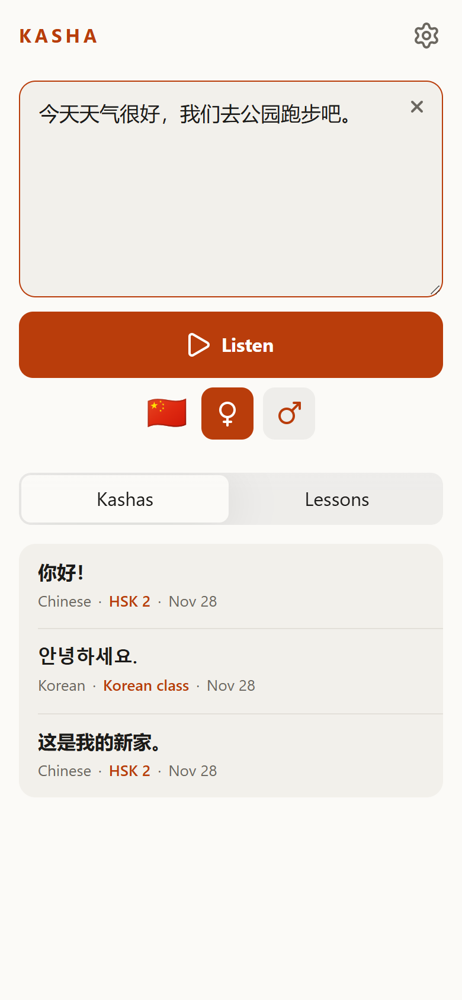
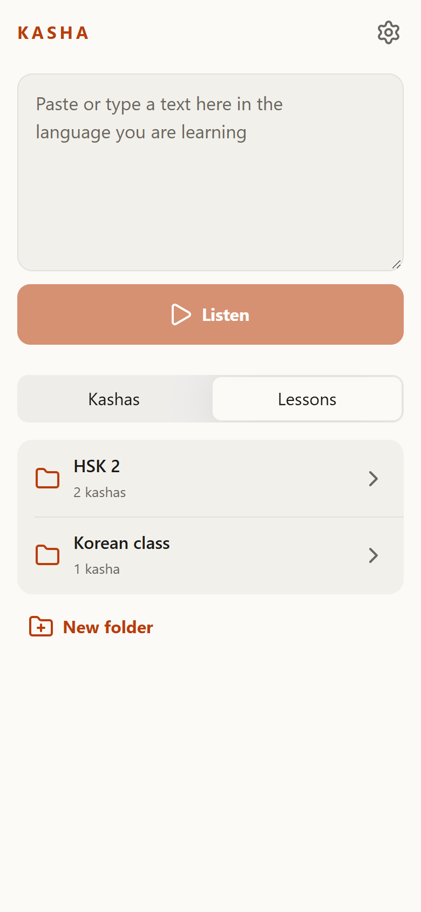

  <picture>
    <source media="(prefers-color-scheme: dark)" srcset="docs/images/kasha-dark.png">
    
  </picture>

  <b>English</b> · <a href="README.es.md">Español</a> · <a href="README.ru.md">Русский</a>

<h3 align="center"><i>Каша в голове</i></h3>

  Is learning languages turning your head to porridge? 
  <b>KA</b>raoke <b>SHA</b>dowing serves it up one spoonful at a time.

  <i>Kasha v golove</i>, “porridge in the head”, is how Russians say your head is a muddle.

  
  
  
  
  
  

Paste a text in the language you're learning and listen with each word lit up as it's spoken. You repeat right behind it: that's *shadowing*.

| 1 · Paste and listen | 2 · Listen and repeat | 3 · Save it |
|:---:|:---:|:---:|
|  |  |  |
| Kasha recognises the language by itself. The flag tells you which; ♀ and ♂ pick a female or male voice. | The word being spoken lights up, with its pinyin on top. You repeat it right after. | Each text with its audio is a **kasha**. Save it in a folder and practise whenever you like. |

## What it already does

- **Recognises the language** of the text and always reads it with the same voice for that language, female or male. Your usual one is set in Settings, and on the home screen you can switch it for that text only.
- **Pinyin** over each Chinese word and **romanization** for Korean. One button hides it.
- **Slower** with the snail button, without the voice dropping in pitch.
- **Repeat sentence**: the same sentence on a loop until you get it.
- **Pause to repeat**: after each sentence it goes quiet just long enough for you to say it.
- **Tap a word** to jump there.
- **Folders** to sort your kashas, and folders inside folders.
- **Settings** one tap away from every screen.
- **Installs like an app** (Settings → "Install Kasha") and opens offline. Making new audio does need the internet.
- **Your phone shows what's playing** on the lock screen, with the Kasha icon.
- **Everything stays on your phone.** No accounts. The text only leaves the phone to be turned into speech, with Microsoft Edge's voices.
- In **Spanish, English and Russian**, with light and dark themes.

## What's next

- **Translation** under each sentence, with a button to show or hide it.
- **More reliable pinyin.** Today it gets about 19 syllables in 20 right in hard sentences. It mostly misses neutral tones (学生 is xuésheng, not xuéshēng) and characters whose reading depends on the sentence, like 得 or 地.

### Ideas for later

If you want one of these sooner, tell us.

- **Record yourself and compare.** On your turn Kasha records you, then plays your sentence right after the original so you can hear the difference.
- **Practise without looking.** A button switches what you see: the whole text, only each word's first letter, or nothing.
- **One voice per character** in dialogues written with "A:" and "B:". With **role mode** you mute one of them and say their lines yourself.
- **Lock-screen and headphone buttons**: play, pause and change sentence with the phone in your pocket.
- **Pronunciation check.** You read the sentence aloud and Kasha marks the words it didn't understand. It depends on the phone's speech recognition, which struggles with some accents.
- **Backup** of your kashas to a file, audio included, in case you change phones.
- **Small touches:** if the internet drops halfway through making audio, carry on where it stopped; an example kasha the first time you open the app; how many times you've practised each kasha; and each sentence played 2 or 3 times before moving on by itself.

---

Going to touch the code? Everything technical is in [docs/DEVELOPMENT.md](docs/DEVELOPMENT.md). Open source under the [MIT](LICENSE) licence.
