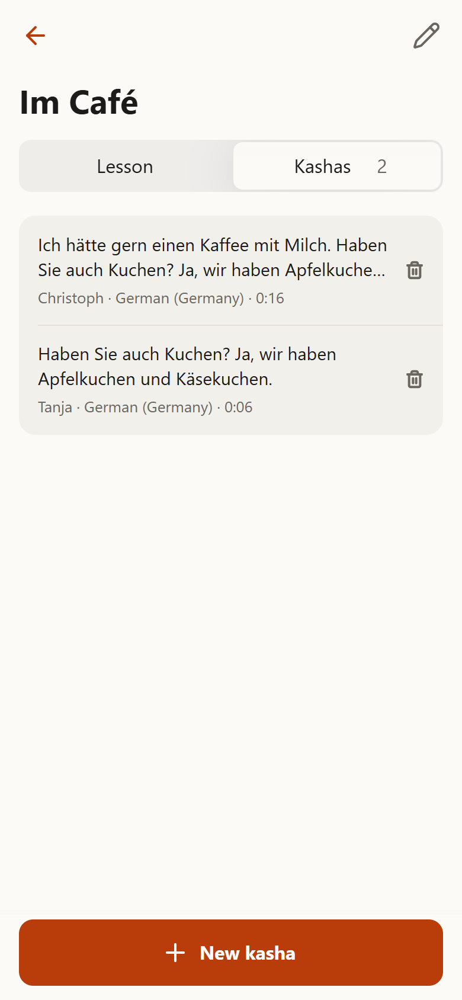
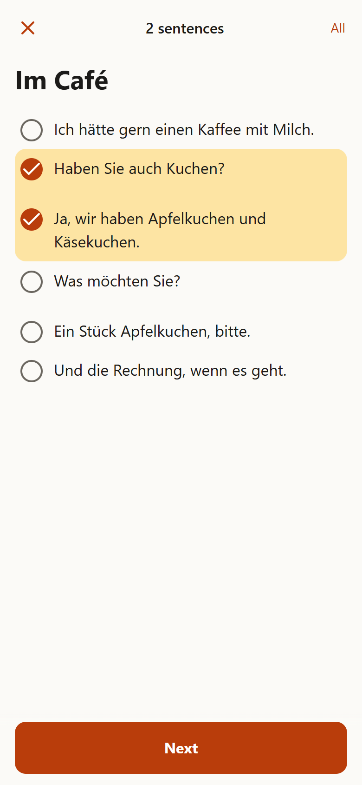
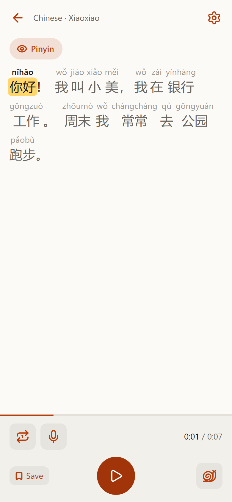

  

  <b>English</b> · <a href="README.es.md">Español</a> · <a href="README.ru.md">Русский</a>

<h3 align="center"><i>Каша в голове</i></h3>

  Is learning languages turning your head to porridge? 
  <b>KA</b>raoke <b>SHA</b>dowing serves it up one spoonful at a time.

  <i>Kasha v golove</i>, “porridge in the head”, is how Russians say your head is a muddle.

  
  
  
  
  
  

Paste a text in the language you're learning, pick a voice, and listen with each word lit up as it's spoken. You repeat right behind it: that's *shadowing*.

| 1 · Save the lesson | 2 · Pick the sentences | 3 · Listen and repeat |
|:---:|:---:|:---:|
|  |  |  |
| A dialogue, an article, your notes. It stays on your phone like a note. | Tap the sentences you want to practise, or “All”. Pick the voice. | The word being spoken lights up. Each part with its audio is a **kasha**. |

## What it already does

- **Speed** from 0.5× to 1×, without the voice dropping in pitch.
- **Repeat sentence**: the same sentence on a loop until you get it.
- **Pause to repeat**: after each sentence it goes quiet just long enough for you to say it.
- **Tap a word** to jump there.
- **Favourite voices**, so you don't have to look for yours every time.
- **Installs like an app** (Settings → “Install Kasha”) and opens offline. Making new audio does need the internet.
- **Everything stays on your phone.** There are no accounts. The text only leaves your phone to be turned into speech, with Microsoft Edge's voices.
- In **English, Spanish and Russian**, with light and dark themes.

## What's next: you choose

These are the ideas we have. Tell us which ones you want and in what order, for example “2, 1 and tweak C”. If something you'd like isn't here, tell us that too.

The size is a rough guide: the smaller it is, the sooner you get it.

### To practise better

#### 1 · Record yourself and compare
On your turn, Kasha records you. Then your sentence plays right after the original, one after the other, so you can hear the difference. It's the heart of shadowing: hearing yourself next to the model. 
**Size:** medium

#### 2 · Practise without looking
An eye button changes what you see: the whole text, only the first letter of each word (“I h g e K m M”), or nothing. You start by reading and end up following the voice by ear alone. 
**Size:** small

#### 3 · A voice for each character
If the lesson is a dialogue whose lines start with “A:” and “B:” (or with names), each character speaks with their own voice. And in **role mode** you mute one of them and say their lines yourself: a conversation where it's your turn to talk. 
**Size:** large

#### 4 · Lock screen controls
Play, pause and change sentence from the lock screen or your headphone buttons, with the phone in your pocket. On iPhone, audio with the app closed has limits set by Apple, so it may not work as smoothly as on Android. 
**Size:** small

#### 5 · Pronunciation check
You read the sentence aloud and Kasha marks the words it didn't understand. It's the flashiest and the least reliable: it depends on the phone's speech recognition, which struggles with some accents and languages. 
**Size:** large

### So you don't lose anything

#### 6 · Backup
Right now your lessons live only on your phone: if you delete the app or switch iPhones, they're gone. With this you save them to a file, with their audio, and get them back whenever you want. 
**Size:** medium

### Small tweaks

- **A · Tap a marked part and it plays.** In the “Lesson” tab, the parts that are already kashas take you straight to the player.
- **B · The usual voice.** When you make another kasha in the same lesson, it suggests the voice you already used there.
- **C · If the internet drops, it carries on.** If the connection drops halfway through making audio, it picks up the missing sentences instead of starting over.
- **D · A sample lesson** already there the first time you open the app, to see it working without pasting anything.
- **E · How many times you've practised it.** A counter and the date of the last time on each kasha.
- **F · Repeat and move on.** Each sentence plays 2 or 3 times and moves on to the next by itself, without touching anything.

---

Going to touch the code? Everything technical is in [docs/DEVELOPMENT.md](docs/DEVELOPMENT.md). Open source under the [MIT](LICENSE) licence.
