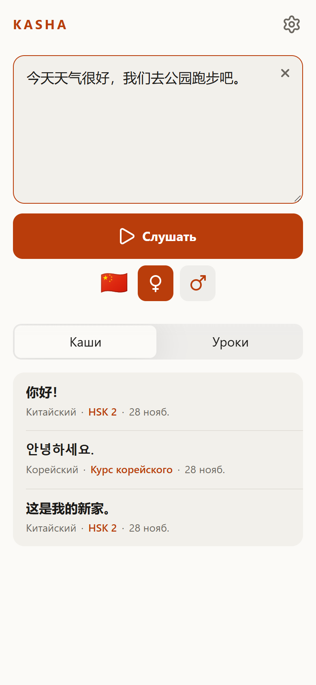
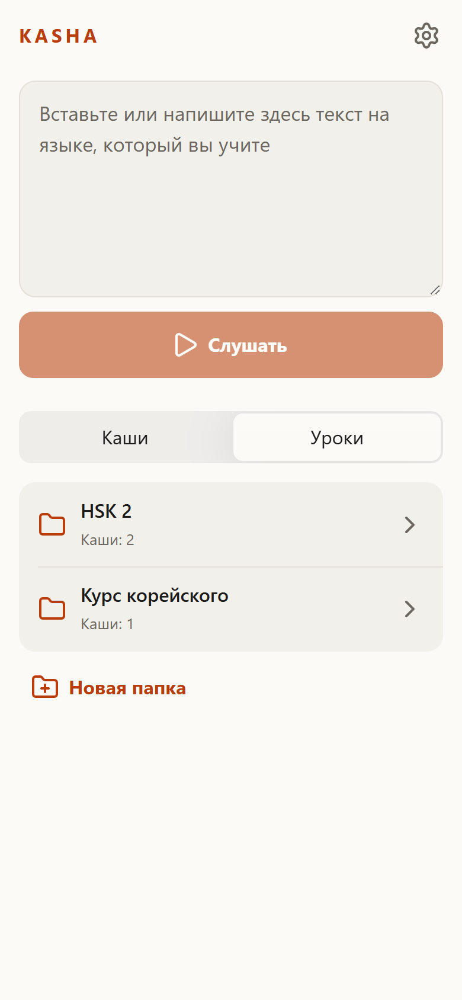

  <picture>
    <source media="(prefers-color-scheme: dark)" srcset="docs/images/kasha-dark.png">
    
  </picture>

  <a href="README.md">English</a> · <a href="README.es.md">Español</a> · <b>Русский</b>

<h3 align="center"><i>Каша в голове</i></h3>

  Изучение языков превратило голову в кашу? 
  <b>KA</b>raoke <b>SHA</b>dowing подаёт его вам по ложечке.

  
  
  
  
  
  

Вставьте текст на языке, который вы учите, и слушайте: каждое слово подсвечивается, пока звучит. А вы повторяете следом — это и есть *шэдоуинг* (shadowing).

| 1 · Вставьте и слушайте | 2 · Слушайте и повторяйте | 3 · Сохраните |
|:---:|:---:|:---:|
|  |  |  |
| Kasha сама узнаёт язык. Флаг показывает какой; кнопками ♀ и ♂ выбираете женский или мужской голос. | Звучащее слово подсвечивается, над ним — пиньинь. Вы повторяете следом. | Каждый текст со своим аудио — это **каша**. Сохраните её в папку и занимайтесь, когда хотите. |

## Что уже умеет

- **Узнаёт язык** текста и всегда читает его одним и тем же голосом для этого языка — женским или мужским. Обычный голос выбирается в настройках, а на главном экране его можно поменять только для этого текста.
- **Пиньинь** над каждым китайским словом и **романизация** для корейского. Убирается одной кнопкой.
- **Медленнее** — кнопкой с улиткой, и голос при этом не становится ниже.
- **Повтор фразы**: одна и та же фраза по кругу, пока не получится.
- **Пауза для повтора**: после каждой фразы приложение замолкает ровно настолько, чтобы вы успели её сказать.
- **Нажмите на слово** — и воспроизведение перейдёт к нему.
- **Папки**, чтобы разложить каши, и папки внутри папок.
- **Настройки** в одно касание с любого экрана.
- **Устанавливается как приложение** (Настройки → «Установить Kasha») и открывается без интернета. Чтобы создать новое аудио, интернет всё-таки нужен.
- **Телефон показывает, что сейчас звучит**, на экране блокировки, со значком Kasha.
- **Всё остаётся в вашем телефоне.** Никаких аккаунтов. Текст покидает телефон только для того, чтобы превратиться в речь, голосами Microsoft Edge.
- На **испанском, английском и русском**, со светлой и тёмной темой.

## Что дальше

- **Перевод** под каждой фразой, с кнопкой, чтобы показать или скрыть его.
- **Более точный пиньинь.** Сейчас в сложных фразах он верен примерно в 19 слогах из 20. Чаще всего ошибается в нейтральном тоне (学生 — это xuésheng, а не xuéshēng) и в иероглифах, чьё чтение зависит от фразы, вроде 得 или 地.

### Идеи на потом

Если какая-то нужна раньше, скажите нам.

- **Запишите себя и сравните.** В вашу очередь Kasha записывает вас и проигрывает вашу фразу сразу после оригинала, чтобы вы услышали разницу.
- **Тренировка без подсказок.** Кнопка меняет то, что видно: весь текст, только первые буквы слов или ничего.
- **Свой голос для каждого персонажа** в диалогах с «A:» и «B:». В **режиме роли** вы заглушаете одного из них и говорите за него сами.
- **Кнопки на экране блокировки** и в наушниках: воспроизведение, пауза и переход между фразами, пока телефон в кармане.
- **Оценка произношения.** Вы читаете фразу вслух, и Kasha отмечает слова, которые не разобрала. Зависит от распознавания речи в телефоне, а оно ошибается с некоторыми акцентами.
- **Резервная копия** каш в файл, вместе с аудио, на случай смены телефона.
- **Мелочи:** если интернет пропал посреди создания аудио, продолжить с того же места; пример каши при первом запуске; сколько раз вы занимались с каждой кашей; и чтобы каждая фраза звучала 2–3 раза и сама переходила к следующей.

---

Хотите заглянуть в код? Всё техническое — в [docs/DEVELOPMENT.md](docs/DEVELOPMENT.md) (на английском). Открытый код под лицензией [MIT](LICENSE).
