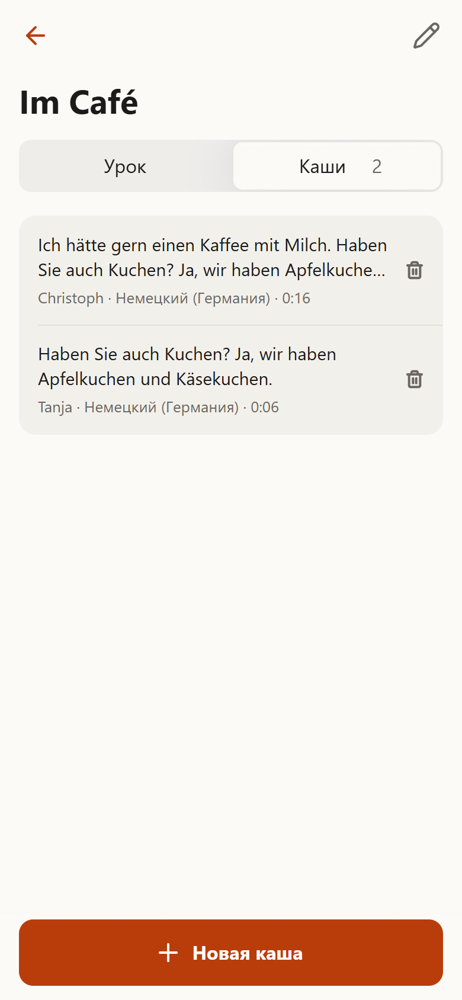
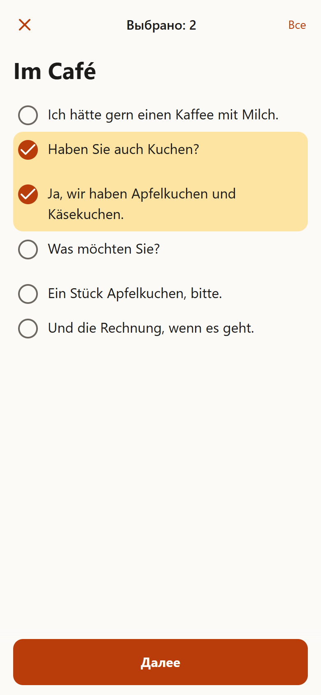
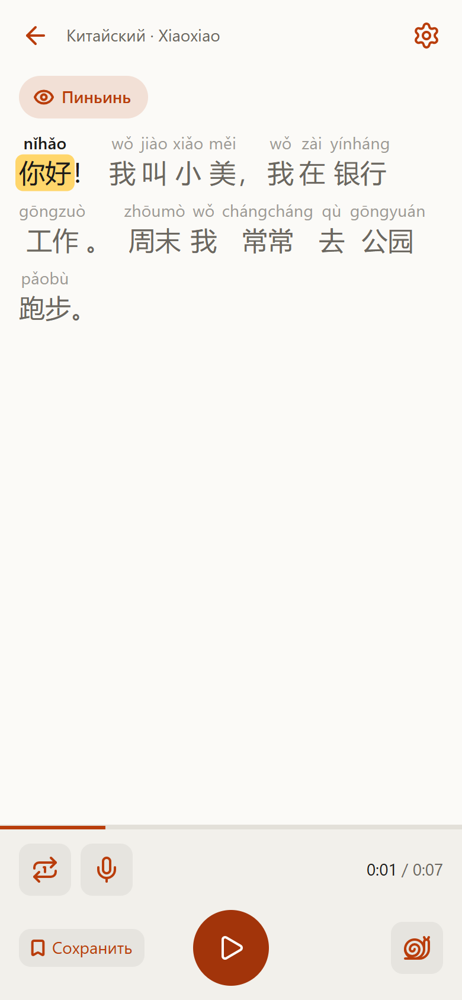

  <picture>
    <source media="(prefers-color-scheme: dark)" srcset="docs/images/kasha-dark.png">
    
  </picture>

  <a href="README.md">English</a> · <a href="README.es.md">Español</a> · <b>Русский</b>

<h3 align="center"><i>Каша в голове</i></h3>

  Изучение языков превратило голову в кашу? 
  <b>KA</b>raoke <b>SHA</b>dowing подаёт его вам по ложечке.

  
  
  
  
  
  

Вставьте текст на языке, который вы учите, выберите голос и слушайте: каждое слово подсвечивается, пока звучит. А вы повторяете следом — это и есть *шэдоуинг* (shadowing).

| 1 · Сохраните урок | 2 · Выберите фразы | 3 · Слушайте и повторяйте |
|:---:|:---:|:---:|
|  |  |  |
| Диалог, статья, ваши заметки. Урок хранится в телефоне, как заметка. | Отметьте фразы, которые хотите отработать, или нажмите «Все». Выберите голос. | Звучащее слово подсвечивается. Каждый кусочек со своим аудио — это **каша**. |

## Что уже умеет

- **Скорость** от 0,5× до 1×, и голос при этом не становится ниже.
- **Повтор фразы**: одна и та же фраза по кругу, пока не получится.
- **Пауза для повтора**: после каждой фразы приложение молчит ровно столько, чтобы вы успели её произнести.
- **Нажмите на слово** — и воспроизведение перейдёт к нему.
- **Избранные голоса**, чтобы не искать свой каждый раз.
- **Устанавливается как приложение** (Настройки → «Установить Kasha») и открывается без интернета. Чтобы создать новое аудио, интернет всё-таки нужен.
- **Всё остаётся в вашем телефоне.** Никаких аккаунтов. Текст покидает телефон только для того, чтобы превратиться в речь голосами Microsoft Edge.
- На **русском, английском и испанском**, со светлой и тёмной темой.

## Что дальше: выбираете вы

Вот идеи, которые у нас есть. Напишите, какие вы хотите и в каком порядке, например «2, 1 и мелочь C». Если вам не хватает чего-то, чего здесь нет, тоже напишите.

Размер примерный: чем меньше, тем раньше вы это получите.

### Чтобы лучше тренироваться

#### 1 · Запишите себя и сравните
Когда наступает ваша очередь, Kasha записывает вас. Потом ваша фраза звучит сразу после оригинала, одна за другой, чтобы вы услышали разницу. Это сердце шэдоуинга: слышать себя рядом с образцом. 
**Размер:** средний

#### 2 · Тренировка без подсказок
Кнопка с глазом меняет то, что вы видите: весь текст, только первые буквы слов («I h g e K m M») или ничего. Начинаете с чтения, а заканчиваете тем, что следуете за голосом только на слух. 
**Размер:** маленький

#### 3 · Свой голос у каждого персонажа
Если урок — это диалог, где строки начинаются с «A:» и «B:» (или с имён), каждый персонаж говорит своим голосом. А в **режиме роли** вы выключаете одного из них и говорите его реплики сами: разговор, в котором ваша очередь говорить. 
**Размер:** большой

#### 4 · Управление с экрана блокировки
Воспроизведение, пауза и переход между фразами с экрана блокировки или кнопками наушников, пока телефон лежит в кармане. На iPhone у звука при закрытом приложении есть ограничения от Apple, поэтому там может работать не так гладко, как на Android. 
**Размер:** маленький

#### 5 · Оценка произношения
Вы читаете фразу вслух, а Kasha отмечает слова, которые не разобрала. Самая эффектная и самая ненадёжная идея: всё зависит от распознавания речи в телефоне, а оно ошибается с некоторыми акцентами и языками. 
**Размер:** большой

### Чтобы ничего не потерять

#### 6 · Резервная копия
Сейчас ваши уроки живут только в телефоне: если удалить приложение или сменить iPhone, они пропадут. С этой функцией вы сохраняете их в файл вместе с аудио и восстанавливаете, когда нужно. 
**Размер:** средний

### Мелкие улучшения

- **A · Нажмите на отмеченный кусочек — и он зазвучит.** На вкладке «Урок» кусочки, из которых уже сделаны каши, сразу открывают плеер.
- **B · Привычный голос.** Когда вы создаёте ещё одну кашу в том же уроке, приложение предлагает голос, который вы там уже выбирали.
- **C · Пропал интернет — продолжаем.** Если связь оборвётся посреди создания аудио, приложение досоздаст недостающие фразы, а не начнёт всё заново.
- **D · Готовый урок-пример** при первом запуске, чтобы посмотреть, как всё работает, ничего не вставляя.
- **E · Сколько раз вы тренировались.** Счётчик и дата последней тренировки у каждой каши.
- **F · Повторить и дальше.** Каждая фраза звучит 2 или 3 раза и сама переходит к следующей, ничего нажимать не нужно.

---

Хотите заглянуть в код? Всё техническое — в [docs/DEVELOPMENT.md](docs/DEVELOPMENT.md) (на английском). Открытый код под лицензией [MIT](LICENSE).
